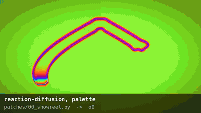

# hydrapy



[Hydra](https://hydra.ojack.xyz) — Olivia Jack's browser video synth — ported to Python, then pushed in a
modular-synth direction: every parameter is a CV input, there's a wavefolder, Conway's Life and
Gray–Scott reaction–diffusion run as feedback ops, a Rutt-Etra scan processor and a GPU pixel sorter,
painted-film, VHS and Super 8 layers, Fischinger's charcoal oscillators, a patch that draws its own
soundtrack, and patches export back to Hydra, to standalone WebGL pages, or to video files.

`docs/tour.mp4` (5 min) shows every primitive for a second and then the combination patches;
`python docs/tour.py` re-renders it.

```python
from hydrapy import *

osc(10, 0.1, 0.8).rotate(Lfo(0.1, lo=0, hi=6.28)).kaleid(5).out(o0)
src(o0).blur(2).edge().palette(0, 0.33, 0.67, Lfo(0.05)).out(o1)
render(o1)

save_gif(render_frames(seconds=4), "out.gif")        # CPU, anywhere
to_html(path="out.html")                              # live WebGL page, no server needed
print(patch_to_hydra(strict=False))                   # paste into hydra.ojack.xyz
```

Two backends evaluate the same chain:

* **NumPy** — runs anywhere, deterministic, slow (≈1–5 fps at 320×180 for feedback patches). Home of
  the CPU-only ops (`pixelsort`).
* **GLSL** — the chain compiles to fragment shaders exactly the way Hydra compiles it (same nesting,
  same function bodies). Used by the HTML export (WebGL2, with a WebGL1 fallback) and by the
  [moderngl](https://github.com/moderngl/moderngl) backend for headless GPU rendering or a live window.

Every op is defined once, with a GLSL body *and* a NumPy twin; the test suite renders every op on
both and asserts they agree to within 8-bit tolerance (they do, except for per-pixel hash noise,
where float32 `sin` of huge arguments isn't portable even between GPUs).

## Install

```
pip install numpy pillow imageio            # core: CPU renderer, GIF, PNG, HTML export
pip install moderngl                        # GPU rendering (headless via EGL on Linux)
pip install glfw                            # `hydrapy live`: a window
pip install imageio-ffmpeg                  # MP4 export, decoding mp3/flac for Audio
pip install opencv-python                   # webcam in the GL backend (the HTML export uses getUserMedia)
pip install sounddevice                     # CV in/out through a DC-coupled interface (ES-6 / ES-3)
pip install python-osc mido python-rtmidi aalink   # OSC, MIDI, Ableton Link
```

Or `pip install -e .[all]` from this directory. Python 3.9+.

## The sixty-second tour

```python
from hydrapy import *

# 1. Hydra, as you know it. camelCase and snake_case both work.
osc(20, 0.1, 1).modulate(noise(3), 0.3).kaleid(4).out(o0)

# 2. Arrays are Seq, functions are Fn (or just a lambda), bpm is set_bpm.
set_bpm(120)
osc(Seq([10, 20, 40]).fast(2).smooth(), 0.1, Fn(lambda ctx: ctx.time % 1)).out(o1)

# 3. Signals: LFOs, clocks, envelopes, sample & hold, random drift — with arithmetic.
env = Env(Clock(1), attack=0.02, decay=0.5)          # retriggered every beat
osc(Lfo(0.1, lo=5, hi=40), 0.1, SH(4) * 2).scale(1 + env * 0.5).out(o2)

# 4. Per-pixel CV: any float parameter accepts a chain. Hydra can't do this.
osc(noise(2).r() * 30 + 5).rotate(fbm(3) * 6.28).out(o3)

# 5. Feedback ops that need neighbours: Life and reaction–diffusion.
src(o0).rd(feed=0.037, kill=0.06, iterations=8).add(shape(6, 0.05).color(0, 1, 0), 0.1).out(o0)

# 6. Chains combine with operators.
(osc(30) * noise(4) + shape(3).luma() | rings(8) ^ gradient()).out(o1)

render(o0)
```

Render it:

```
hydrapy render patch.py -o out.gif --seconds 6 --fps 30 --size 320x180 --warmup 60
hydrapy render patch.py -o out.mp4 --seconds 60 --size 1280x720 --gpu
hydrapy html   patch.py -o patch.html          # standalone WebGL page (keys: s = save png, f = fullscreen, space = pause)
hydrapy live   patch.py                        # window, needs moderngl + glfw
hydrapy ansi   patch.py                        # in the terminal, half-block ANSI
hydrapy hydra  patch.py --loose                # Hydra JS (drops the ops Hydra lacks)
hydrapy glsl   patch.py                        # the fragment shaders, pass by pass
hydrapy import sketch.js -o patch.py           # Hydra JS -> Python
hydrapy ops                                    # list every op
```

`hydrapy render sketch.js` works too — Hydra sketches are imported on the fly.

### Hardware video encoding

MP4/MOV/MKV export now defaults to `--encoder auto`: test a real frame at the output size
and frame rate, choose a working hardware H.264 encoder, or fall back to software `libx264`.
The CLI prints which encoder and FFmpeg executable it selected. Rendering (`--gpu`) and
encoding (`--encoder`) are independent; hardware encoding also works with the NumPy renderer.

```sh
hydrapy encoders --size 1920x1080 --fps 30
hydrapy render patch.py -o out.mp4 --seconds 60 --size 1920x1080 --gpu
hydrapy render patch.py -o out.mp4 --gpu --encoder nvenc --bitrate 16M
hydrapy render patch.py -o out.mp4 --gpu --encoder videotoolbox --bitrate 16M
hydrapy render patch.py -o out.mp4 --encoder software --quality 8
```

| Choice | FFmpeg encoder | Hardware |
|---|---|---|
| `nvenc` | `h264_nvenc` | NVIDIA, including RTX 4090 |
| `videotoolbox` | `h264_videotoolbox` | macOS VideoToolbox |
| `qsv` | `h264_qsv` | Intel Quick Sync |
| `amf` | `h264_amf` | AMD AMF |
| `vaapi` | `h264_vaapi` | Linux VAAPI (`--device /dev/dri/renderD128` to choose a node) |
| `software` | `libx264` | CPU |

An explicit encoder fails with the FFmpeg error if unavailable; only `auto` falls back.
Auto tries NVIDIA, VideoToolbox, Quick Sync, AMF, then VAAPI (VideoToolbox first on macOS),
across system and imageio-provided FFmpeg builds, before trying software. Drivers, device
access, and an FFmpeg build containing the encoder are required; appearing in FFmpeg's
encoder list alone is insufficient. Use `--ffmpeg /path/to/ffmpeg` (Python: `ffmpeg=...`)
or `IMAGEIO_FFMPEG_EXE` to restrict probing and export to one executable.

```python
from hydrapy import iter_frames, save_mp4, video_encoders

for candidate in video_encoders(size=(1920, 1080), fps=30):
    print(candidate.name, candidate.available, candidate.ffmpeg, candidate.reason)

save_mp4(iter_frames(seconds=60, fps=30), "minute.mp4", fps=30,
         encoder="auto", bitrate="16M")
```

`quality`/`--quality` is 1–10 (default 8). Software retains the previous x264 CRF mapping;
hardware quality settings are codec-specific. VideoToolbox and AMF use a bitrate estimate
based on size, frame rate, and quality. `bitrate`/`--bitrate` overrides quality control for
any encoder and requests a target bitrate, not a fixed output size or identical visual quality.
Output remains H.264 with 4:2:0 chroma; WebM is not supported by this export path.

Frames stream once; the first is buffered while encoders are tested. If encoding fails
mid-stream, export stops without retrying the stateful renderer, removes temporary files,
and preserves any existing destination. Soundtrack audio is muxed as AAC without re-encoding
the video. Hardware encoding offloads compression; frames still pass through CPU memory,
so this does not yet eliminate GPU readback or RGB conversion costs.

## What's different from Hydra

| Hydra | hydrapy |
|---|---|
| `osc(10).out(o0)` | same |
| `[1, 2, 3].fast(2).smooth()` | `Seq([1, 2, 3]).fast(2).smooth()` — or just pass a list; identical timing (bpm/60 steps per second, default bpm 30) |
| `() => time * 0.1`, `({time}) => ...` | `Fn(lambda ctx: ctx.time * 0.1)` or a bare lambda; `ctx` has `time, frame, bpm, width, height, mouse` |
| `bpm = 60`, `speed = 2` | `set_bpm(60)`, `speed(2)` |
| `s0.initCam()`, `s0.initImage(url)` | `src(Camera())`, `src(Image("file.png"))`, `src(Video("clip.mp4"))` |
| `a.fft[0]`, `a.setSmooth()` | `a = Audio.from_file("track.wav")` (offline, frame-accurate) or `Audio()` (microphone in the HTML export); `a.fft[i]`, `a.vol`, `a.flux`, `a.set_smooth()`… |
| `render()` shows all four outputs | `render(oN)` shows one; default `o0` |
| `.r()`, `.g()`, `.b()`, `.a()` | same (they return the channel as grey) |
| Hydra's 12 extra-ish GLSL helpers (`_luminance` etc.) | same names, same numbers |

Semantics that are reproduced on purpose: coordinates run 0–1 with y up; coordinate ops apply to the
*coordinate* so later ones act first (`osc().rotate(a).scale(b)` → `osc(rotate(scale(st, b), a))`);
`src(oN)` inside `oN`'s own chain reads the previous frame, inside a later output it reads the current
one; `shape` and `kaleid` keep Hydra's `3.1416`; `color()` with negative values inverts; the
`luminance` weights are Hydra's (0.2125, 0.7154, 0.0721).

What Hydra has that this doesn't (yet): `initScreen`, `setFunction` (write ops in Python instead,
see below), the multi-output `render()` grid, `.setResolution` mid-run, and the `p5`/`hydra-synth`
extensions. Hydra's `sum()` returned a float where a vec4 was expected; here it returns grey.

## The additions

### Signals: CV for every knob

All of these are pure functions of time, so they evaluate identically in Python, in the exported
HTML, and (as arrow functions) in Hydra.

| signal | what |
|---|---|
| `Lfo(freq, shape, lo, hi, phase, width)` | `sine`, `tri`, `saw`, `square`, `pulse` |
| `Seq([...]).fast().smooth().offset().ease().fit()` | Hydra arrays, same clock |
| `Clock(div, bpm)` | phase 0–1, `div` cycles per beat |
| `Env(clock, attack, decay, curve, lo, hi)` | attack/decay retriggered by a clock (fractions of its cycle) |
| `SH(rate, lo, hi, seed)` | sample & hold noise |
| `Drift(rate, lo, hi, seed)` | smooth random wander (1-D value noise) |
| `Time()`, `Mouse('x' | 'y')` | the obvious |
| `Fn(callable)` | anything; baked into a lookup table for HTML/Hydra export |
| `Audio.from_file(path).fft[i]`, `.vol`, `.flux` | Bark-band loudness like Hydra's Meyda pipeline; `flux` is onset strength (a free kick envelope) |

Arithmetic: `Lfo(1) * 2 + 0.5`, `(a.fft[0] ** 2).clip(0, 1)`, `.map(lo, hi)`, `.quantize(n)`,
`.sin()`, `.abs()`, `.smoothstep()`.

### Per-pixel parameters

Any float input accepts a chain. The chain is evaluated at the same coordinate the op receives and
its red channel is used (`.r()`, `.g()`, `.luma()` to choose). `osc(noise(2) * 40)` is an FM
oscillator; `rotate(fbm(2) * 3)` is a domain warp; `kaleid(noise().posterize(3, 1).r() * 4 + 3)` is a
kaleidoscope whose mirror count varies across the frame. Hydra's export can't express this and says
so.

### Texture ops and multi-pass compilation

`blur sharpen edge emboss dilate erode life rd chroma pixelsort` need the neighbourhood of a pixel,
which a pointwise shader can't see. The compiler splits the chain before such an op into its own
pass that renders to an intermediate target; the op then samples that texture. Nested and repeated
splits work (`osc().blur(2, iterations=3).edge().add(noise().blur(), 0.5)` is five passes). On the
CPU the prefix is just an array.

* `life()` — Conway's Life on the red channel; green keeps a decaying trail, blue the previous state.
  `src(o0).life().add(noise(40).thresh(0.7).color(1, 0, 0), 0.1).out(o0)`
* `rd(feed, kill, da, db, iterations)` — Gray–Scott. Black counts as pure A, so seed B with green:
  `src(o0).rd(0.055, 0.062).add(shape(4, 0.05).color(0, 1, 0), 0.1).out(o0)`; `.g()` is the pattern.
  Classic parameter pairs: 0.037/0.06 worms, 0.03/0.062 coral, 0.055/0.062 spots, 0.025/0.06 mitosis.
* `iterations=n` runs the op n times per frame (ping-ponging two targets) — RD wants 4–16.

### The rest

* `fold(gain, bias)` — wavefolder on colour, `abs(mod(x - 1, 2) - 1)`. Push `gain` with an envelope.
* `polar()` / `unpolar()` — in and out of polar coordinates; `twist`, `fisheye`, `mirror`, `wobble`,
  `glitch` (block displacement), `displace` (centred `modulate`).
* `fbm`, `rings`, `grid`, `white` sources; `gamma`, `levels`, `dither` (ordered Bayer), `palette`
  (Quilez cosine palette on luminance), `grain`, `vignette` colour ops; `lighten`, `darken`,
  `screen`, `overlay`, `wipe` blends.
* `pixelsort` — CPU only; the compiler refuses it for GLSL with a clear error.
* Operators: `a + b` add, `a - b` sub, `a * b` mult, `a | b` layer, `a ^ b` diff. Numbers become
  `solid()`. Mind Python precedence (`^` binds tighter than `|`).
* `Patch()` objects for more than one synth; `o0..o3` are matched by index so they work with any patch.


## Painted film (the Brakhage layer)

Hand-painted film is physics plus artifacts, and both are cheap to model. `hydrapy.recipes`
composes the pieces; the ops underneath are ordinary ops.

**The dye model.** A projector shines white light through clear leader painted with transparent
dyes. Each layer multiplies the light by its transmittance (Beer–Lambert), so red over blue goes
black the way inks do, doubled paint goes dark, and thin paint tints. A *layer* is any chain whose
rgb is the colour the dye lets through and whose alpha is its thickness (straight, not
premultiplied; `alpha(chain)` sets it from another chain's luminance without premultiplying).

```python
leader = solid(1, 1, 1)                                     # clear stock; solid(0,0,0) is black leader
painting = leader.stain(drops(3, 0.6, 0.5, 1.2, seed=1)) \
                 .stain(drops(5, 0.5, 0.5, 2.5, seed=2, hue=0.62), 0.8) \
                 .stain(solid(0, 0, 0).alpha(crackle(7, 0.03)), 0.3)
```

**Sources.** `drops` are dye drops on a jittered grid, thicker at the drying rim and mottled inside,
each its own colour, stretched into strokes with `stretch`; `crackle` is dried-paint cracking
(warped Voronoi borders); `veins` is ridged noise for membranes and leaf veins; `scratches` run
along the strip and jitter per frame; `dust` is specks and hairs in the gate. `bleed` spreads a
layer's edges like ink. All of them are seeded, and the seed can be a signal.

**Time.** Three ways to get his time, which you can combine:

* a fresh painting per frame: `seed=SH(24, 0, 99)`; `SH(8, …)` holds each one for three frames
  (step printing);
* paint that runs along the strip: `.pan(0, 0, 0, 24)` moves one frame height per frame, so the
  painting is one tall image and smears continue from frame to frame — `handpainted(strip=24)`;
* the projector: `film(chain)` adds gate weave, flicker, scratches, dust, grain, bloom and a
  vignette, each frame-rate aware.

**Real matter.** Brakhage pressed moth wings and grasses between strips of tape. Photograph your
own on a light table and point a `Bank` at the folder: `src(Bank("matter/", rate=24, hold=2,
mode="random"))` shows one photo per frame. `mothlight(bank=…)` turns the photos into dye (dark
matter blocks light, pale matter tints it). Banks work on all three backends; the HTML export embeds
the images.

**Instead of a GAN.** `Quilt("texture.jpg", size, count=24)` synthesises `count` new images from
one photo by image quilting (Efros–Freeman: random patches stitched along minimum-error seams).
Every frame is a different image with the same statistics as the original, which is the per-frame
discontinuity a GAN's smooth latent space would work against. About a second a frame on a CPU, no
training; `src(q)` uses the bank. (`quilt()` is also available on its own.) If you do want a learned
model later, the frames hydrapy exports are a reasonable init for an img2img diffusion pass with
independent seeds per frame; that is a separate pipeline.

Patches `11_handpainted.py`, `12_mothlight.py`, `13_quilt.py` show all of it.
## Text, line drawings, the canvas in 3D, and the delay line

These are the things a Hydra + p5.js practice did outside Hydra.

**Text and drawings** are static textures like `Image`, rendered once with PIL (straight alpha), so
they work on all three backends and inside `Bank`:

```python
title = Text("ANCHORITE", font="DejaVuSerif-Bold", size=0.2, color=(0.85, 0.1, 0.05))   # any font file or name
plot = Lines("drawing.svg", stroke=1.6, color=(0.05, 0.08, 0.05))                         # paths, polylines, transforms, arcs
plants = Lines(meadow(seed=3), stroke=1.5)                                                 # or polylines in 0..1 coordinates
paper.stain(src(plot)).stain(src(title))                     # as dye
field.mult(src(plot).a().invert())                           # as a mask
Bank([Lines(meadow(seed=s)) for s in range(8)], rate=12)     # one drawing per frame
```

`hydrapy.drawing.plant()` / `meadow()` generate roadside plants as polylines (a stand-in until
your own drawings are in the folder); `to_svg()` writes polylines back out for the plotter.

**The canvas in 3D.** `plane3d`, `sphere3d`, `cylinder3d` are texture ops: the chain so far is
rendered, then ray-cast onto the shape by a perspective camera, with optional Lambert shading and
fog. Outside the shape the result is transparent, so layer it over a ground:

```python
ground.layer(tex.plane3d(rotX=1.25, distance=0.55, fov=70, wrap=1, fade=0.35))   # the floor
      .layer(tex.sphere3d(rotY=Time() * 0.4, radius=0.32, shade=0.6))
      .layer(src(Text("CANVAS")).cylinder3d(rotX=0.25, rotY=Time() * 0.6))
```

**The delay line.** `delay(oN, k)` is output N as it was k frames before what `src(oN)` gives
(`delay(o0, 0) == src(o0)`). Each output keeps a ring of textures as deep as the largest delay used,
on every backend. Echoes, A/B rolls, frame holds and motion extraction without spending outputs:

```python
src(o0).add(delay(o0, 4).color(0.8, 0.3, 0.9), 0.7).add(delay(o0, 8).color(0.3, 0.9, 0.8), 0.5)   # echoes
src(o0).blend(delay(o0, 6), Clock(1).smoothstep().quantize(1))                                     # A/B roll
src(o0).diff(delay(o0, 2)).thresh(0.1)                                                              # motion only
```

**The p5 loop.** A Hydra + p5 practice often ran Hydra's canvas through p5's `plane()` and back
in as `s0`. That round trip is `src(o0).plane3d(...)` fed back into `o0` here; `patches/17_p5_hydra_loop.py`
is the `p5js-hydra-fxhash` template rebuilt that way, and `Fx("oo…")` is `fxrand()` with the
`rnd_btw / rnd_btwexp / rnd_int` helpers, so a hash reproduces its edition. `hydrapy import file.js`
is lenient: it pulls the Hydra statements out of a p5 sketch, and a source it can't read offline
(`s0.init({src: canvas})`) becomes an `External` placeholder to swap for an Image, Bank or the loop.

Patches `14_text_and_lines.py`, `15_canvas_in_3d.py`, `16_delay_line.py`, `17_p5_hydra_loop.py`;
`docs/tour.mp4` walks through every primitive and the combination patches (`python docs/tour.py`
re-renders it).

## The modular, OSC, MIDI and Link

`hydrapy.live` turns outside control into ordinary signals, so anything below plugs into any
parameter. Live sources only move in real time (`hydrapy live`); for a finished render, record them
and use the file forms.

**Control voltage in (ES-6, ES-8, any DC-coupled interface).** An ES-6 arrives as DC-coupled audio
inputs on the ADAT channels of your interface; `hydrapy devices` lists devices and channels.

```python
cv = CvIn(device="ES-8", channels=[8, 9, 10, 11], volts_per_fs=10)   # Expert Sleepers: ±10 V = full scale
cv.cv[0]                       # volts           cv.uni(0)  0..1 for 0..+10 V      cv.bi(1)  -1..1 for ±5 V
cv.volt_oct(2)                 # Hz from 1 V/oct
gate = cv.trig(3, threshold=1.0, length=0.6)      # phase since the last rising edge
osc(cv.uni(0).map(6, 50)).scale(1 + Env(gate, 0.02, 1.0)).out(o0)
cv.audio(2).fft[1]             # an audio-rate channel through the same Bark analyser as Audio
```

`CvIn.from_file("performance.wav", channels=[0, 1, 2, 3])` gives the same signals from a
multichannel recording, sampled at each frame's time: record the CV in your DAW alongside the audio,
then `hydrapy render` at any resolution with no dropouts and the envelopes landing on the gates.

**Control voltage out (ES-3).** Values become voltages, ramped across each audio block:

```python
out = CvOut(device="ES-8", channels=[8, 9])
out.send(0, Probe(o0, 0.5, 0.5, 0.08, "luma", lo=0, hi=8))   # the centre's brightness, 0..8 V
out.send(1, Lfo(0.25, "tri", -5, 5))                          # a plain LFO in volts
```

`Probe(output, x, y, size, channel, lo, hi)` reads a region back after every frame (one frame of
latency), on both backends; that's the image as a sequencer. `CvOut(file="cv.wav", fps=30)` writes
the voltages as a multichannel WAV during an offline render instead, to play from the DAW into the
ES-3 next to the video.

**Audio out: the painted oscillator.** `out.send(k, Soundtrack(o0, x=0.5, gain=0.5))` sends a drawn
soundtrack (below) down an ES-3 channel at audio rate — a VCO made of charcoal, ±5 V, to be put
through a filter — while the other channels carry CVs, and the ES-6 brings pitch, wobble and grit
back in. `patches/26_painted_oscillator.py` is that loop: a `wave` stroke standing upright down the
middle of the frame, the column through it read as the waveform, 1 V/oct from `wave(2 ** pitch * 2)`
(`pitch` a `CvIn` channel in volts); a damped `harmonograph` as a second, rougher voice. The file
mode records the audio channels too.

**OSC.** `OscIn(57120).value("/synth/freq", default, lo, hi, smooth)`, `.trig("/kick")`;
`OscOut(host, port).send("/addr", signal_or_probe)`. VCV Rack's cvOSCcv makes this a second CV path
without hardware.

**MIDI.** `Midi("port name")`: `.cc(74)` 0..1, `.note(60)` velocity while held, `.gate(60)` a
trigger, `.bend`, and `.clock` as a transport that follows MIDI clock. Needs `mido python-rtmidi`.

**Ableton Link.** `default_patch().transport = Link(bpm=120)`; `ctx.time` then runs on the session's
beat grid and `bpm` follows the session tempo, so every `Clock`, `Seq` and `Env` lands on the shared
beat and `Clock(1)` is the Link beat phase. Needs `aalink`. A transport is any object with `now()`
and `bpm`; `MidiClock` is the other one supplied.

`patches/18_modular.py` is the whole loop: CV in, envelopes from gates, two probes back out, Link
as the clock, with file and synthetic fallbacks so it runs anywhere. Calibrate with a known voltage:
the ES-6/ES-3 are nominally ±10 V at full scale, but check one channel against a meter and set
`volts_per_fs` accordingly. Note the browser export can't see any of this (pages freeze live values
at what they were when exported); the GL window is the live venue.

## Entropy locking (after aebrer)

[aebrer](https://www.raster.art/artwork/entropy-locked-recursive-glitch-textures-by-aebrer/about)'s
entropy locking is a seeded random stream that, with a small probability on each draw, gets pulled
back to its seed state — `if (random_int(1,1000) > 997) fxrand = sfc32(...hashes)` — so the
sequence keeps falling into earlier sequences, loops of unpredictable length, "random bottlenecks"
that make a system with too much entropy occupy a [lesser infinity](https://www.raster.art/artwork/lesser-infinities-by-aebrer/about).
When that stream steers pixel feedback the same glitches recur, and recurrence on top of feedback
grows the fractal texture. CC0; ported here with thanks.

```python
fx = Fx("ooYourFxhashHash")                      # fxhash's own sfc32, bit for bit: a hash gives the same numbers as the browser did
lock = EntropyLock("ooYourFxhashHash", rate=24, lock=0.01)   # 24 draws a second from a locked copy of the stream
src(o0).shred(lock, 4, 0.25, 1.5)               # samples of the image copied onto itself (magnified)
       .tear(lock * 7, 3, 0.1, 0.3)              # bands torn sideways
       .blend(osc(20).kaleid(fx.rnd_int(3, 7)), 0.05)
       .out(o0)
```

`Fx(hash, lock=p)` locks any draw sequence (`rand`, `rnd_btw`, `rnd_btwexp`, `rnd_int`, `pick`,
`table`; `reseed()`, `save()`/`restore()` for bottlenecks by hand). `EntropyLock` precomputes its
steps so the HTML export carries the same loops. `tear` and `shred` are coordinate ops, so they are
free and work on any source; `patches/19_entropy_lock.py` is the full loop.

## Video synthesis, tape and small-gauge film

The analog video-synth vocabulary (the LZX / Rutt-Etra end of it), then the two media that most
of that work was ever seen on. `patches/20_video_synth.py`, `21_vhs.py`, `22_super8.py`.

```python
noise(2.5).ruttetra(lines=72, amount=Lfo(0.07, lo=0.1, hi=0.4), glow=0.3)   # scan processor: lines lifted by brightness
gradient().bits(gradient().rotate(1.5708), 0, 6).sinefold(2)                 # ramp XOR ramp at 6 bits, through a sine staircase
src(o0).contours(8, 0.2, fill=0.5)                                           # isolines of luminance (a contour keyer)
src(o2).psort(0.3, 0, iterations=8).blend(pic, Lfo(1/6, "pulse", width=0.03)).out(o2)   # a picture loaded every 6 s, then left to melt
```

* **`ruttetra(lines, amount, thickness, glow)`** — a raster of scan lines, each displaced upward by
  `amount` × the brightness beneath it. Rotate or scale the chain before it to tilt the raster.
* **`contours`**, **`sinefold`**, **`bits`**, **`shear`** — a contour keyer; the sine staircase
  shaper (ramps become rainbows); bitwise XOR/AND/OR between two chains quantised to `depth` bits;
  skew.
* **`psort`** — pixel sorting on the GPU. Each iteration is one odd-even transposition step along
  rows (or columns) inside runs brighter than `threshold`, so `iterations=8` sorts eight pixels'
  worth per frame. Feed it back and the picture melts into sorted streaks over seconds; the
  CPU-only `pixelsort` still sorts a frame completely in one go.

Tape: `yiq(chroma, luma, shift)` is composite-video bandwidth (chroma smeared over a fraction of
the width and delayed, luma softened), `ringing` the overshoot of a deck's sharpening circuit,
`linejitter` the time-base error (every scan line shifts by its own amount, worse in drifting
tracking bands), `headswitch` the tear in the bottom band, `dropouts` the white streaks. Film:
`filmstock` (Kodachrome, Ektachrome, faded, Tri-X), `gate` (the rounded projector aperture),
`grain(amount, rate, size)` with `size` in pixels, and **`set_frame_rate(18)`** — the whole patch
holds `time` to 18 steps a second, so everything judders like the projector, signals included
(16 for Regular 8, 24 for sound speed, `None` to release). All of it is CV-able, so bad tracking can
come from an LFO or from your modular.

```python
from hydrapy.recipes import vhs, super8

vhs(pic).out(o0)                                    # first-generation copy
vhs(pic, generation=4).out(o1)                      # dubbed four times: softer, noisier, shakier each time
super8(pic, stock=0).out(o2)                        # Kodachrome, 18 fps, reddish halation, weave, grain, gate
super8(handpainted(seed=SH(6, 0, 99)), stock=2)     # the painted-film recipes, projected
```

## Fischinger, cut paper, and the drawn soundtrack

Three more things from the history of abstract animation. `patches/23_studie.py`, `24_cutout.py`,
`25_ornament_sound.py`.

**Painted oscillators.** Fischinger's *Studie* films (1929–34) are oscillators drawn in charcoal —
comets, sine sweeps, arcs, pulsing to a record — so here the oscillator is a *stroke*:

```python
harmonograph(3, 2, 0, 0, 1.5708, 0, 1, 0.4, 0.012)        # a Lissajous drawn as a line (f3/f4 > 0: damped double pendulum)
wave(3, 0.2, 0.015, 1, 0, 0.9, taper=1)                    # a sine across the frame, thinning at the ends
arc(0.3, 0, 2.5, 0.04, taper=1, speed=0.5)                 # a comet circling: thick head, thin tail
arc(0.3, 0, 1.0, 0.04, 1).polarRepeat(6, Time() * 0.2)     # six of them around the centre
   .charcoal(0.5, 1.5, 90)                                 # paper tooth and ragged edges
src(o0).layer(dab(0.07, 0.4, angle, 0.8).scroll(x, y).color(r, g, b)).out(o0)   # Motion Painting No. 1: one touch a frame, never erased
src(o0).smear(noise(2, 0.1) * 6.28, 0.02)                  # paint dragged along a flow field (paint on glass)
```

`recipes.studie(o0, beat=Clock(1)).out(o0)` is the whole thing — comets breathing with the beat,
smoke behind them; give it `beat=a.flux` from an `Audio` and it dances to the record. Every stroke
is white with alpha = stroke, so put it on something (`solid().layer(arc(...))`); `layer` /
`over` / `stain` / `alpha` all apply.

**Cut paper.** The flat-graphic animation of the sixties East — Zagreb, Soyuzmultfilm's Khitruk
years, Pannónia, the Polish poster school: `halftone` (a three-angle screen print), `boil` (the line
redrawn by hand every frame), `polarRepeat` (ornament), `filmstock(4)` (Orwo / Sovcolor), and
`set_frame_rate(12)` for animation on twos. `recipes.cutout(chain, levels=3, screen=5)` does the
posterising, boil, misregistration, paper and grading in one go; `Text("КИНО")` works, DejaVu has
Cyrillic.

**The drawn soundtrack.** In 1932 Fischinger photographed ornaments onto the optical track of the
film; the same year in Leningrad Avraamov, Sholpo and Yankovsky were drawing sound by hand and by
machine. `Soundtrack(o0, x=0.5)` reads a vertical strip of an output every frame, top to bottom,
and makes it the next 1/24 s of audio: a pattern repeating *n* times per frame height sounds at
*n × 24* Hz, and the shape of the pattern is the timbre.

```python
notes = Seq([10, 12, 16, 20]).fast(1)                      # stripes per frame -> 240, 288, 384, 480 Hz
shape(Seq([3, 4, 64]).fast(0.25), 0.2).repeat(7, notes).out(o0)   # triangle, square, round: the waveform
track = Soundtrack(o0, x=0.5)                              # what you see down the middle is what you hear
save_mp4(render_frames(seconds=12, fps=24), "ornament.mp4", fps=24, audio=track)   # or `hydrapy render ... --out x.mp4`
```

`docs/ornament_sound.mp4` is twelve seconds of it. The track keeps its own clock (a frame is read
only when 1/fps has passed, so a 60 fps window and a 24 fps render sound the same) and follows a
frame hold (`set_frame_rate(18)` reads at 18, as Super 8 sound did). The HTML export plays it live
(`readPixels` of the strip into the audio output; click to start), so a browser patch can score
itself; `CvOut().send(k, track)` plays it out of a DC-coupled interface into the modular (see the
modular section above).

## Timing, transparent materials, and streaming exports

`set_frame_rate(18)` holds the actual image and feedback history between updates. Display and
CV-output hooks still run at the presentation rate; the optical soundtrack keeps playing held
images. Frame-rate-independent feedback uses a half-life in seconds:

```python
decay = Decay(0.7)
src(o0).mult(solid(decay, decay, decay)).layer(wave(3).color(0.8, 0.2, 0.1)).out(o0)
```

For transparent pigment, fade its **alpha** instead of its RGB. `patches/27_material_controls.py`
demonstrates this, stationary paper under moving pigment, and both radial-repeat modes.

* Strokes carry straight RGB colour (white) with coverage in alpha; `charcoal()` removes coverage
  once. Put them on a picture to see them: `solid().layer(wave(3))` — Hydra's `layer` is exact for
  a straight-alpha layer on an opaque picture. `over()` is source-over for transparent layers on
  transparent layers (pigment kept apart from its paper).
* The display is Hydra's: RGB, with alpha as a fourth channel that `.r()/.g()/.b()`, `mult`,
  `luma` and `mask` use as a number. `set_composite_alpha(True)` shows RGB × alpha over black
  instead — in the window, the HTML page, exports and brightness/sound probes — for patches built
  in straight alpha throughout (patch 27). Raw `Renderer.step()` and `GLRenderer.read_rgba()`
  always return uncomposited RGBA. (`tests/test_patch_brightness.py` holds every example patch to
  its baseline brightness, so a change to this can't darken them silently.)
* `polarRepeat(n)` uses image-space angles, preserving circles on wide and tall frames.
  `polarRepeat(n, aspect=0)` preserves the former normalized-coordinate distortion.
* `recipes.on_paper(pigment, paper_color=(0.94, 0.90, 0.81), tooth=0.35, texture=0.025)` applies
  fixed paper after the pigment's motion. Keep the transparent pigment on its own feedback
  output so the paper does not accumulate or move with it.
* `recipes.studie(..., decay_seconds=0.5, motion=0.4, surface=0.002, surface_rate=12)` separates
  trail lifetime, large-scale movement, and small line jitter. The older `trails` setting remains
  available when `decay_seconds` is omitted.

The CLI streams video frames directly to the encoder. `render_frames()` and `render_frames_gl()`
still return lists for callers that need random access; use their iterator counterparts for
long videos:

```python
from hydrapy.backend_gl import iter_frames_gl
save_mp4(iter_frames_gl(seconds=60, fps=30), "minute.mp4", fps=30)
# CPU: save_mp4(iter_frames(seconds=60, fps=30), "minute.mp4", fps=30)
```

Soundtracks carry fractional samples between optical frames (44.1 kHz / 24 fps alternates
1,837 and 1,838 samples), fill missing audio intervals with the held picture, and resample CV
audio routes using cumulative sample counts. CV files use presentation timestamps rather than
the synthesis hold rate; render warm-up is excluded. Set `record=True` and a sufficiently long
`keep` when exporting audio through the Python API. The CLI does this for its selected soundtrack.
GPU brightness probes reduce their regions before readback; audio strips are read only when due.

## Op reference

### Sources

| op | args | | notes |
|---|---|---|---|
| `noise` | `scale=10, offset=0.1` | Hydra | Simplex noise; offset scales its drift through time. |
| `voronoi` | `scale=5, speed=0.3, blending=0.3` | Hydra | Hydra's animated Voronoi cells. |
| `osc` | `frequency=60, sync=0.1, offset=0` | Hydra | Sine oscillator across x; offset separates the colour channels. |
| `shape` | `sides=3, radius=0.3, smoothing=0.01` | Hydra | Regular polygon with `sides` sides. |
| `gradient` | `speed=0` | Hydra | x in red, y in green, sin(time*speed) in blue. |
| `src` | `tex` | Hydra | Read an output (o0..o3), Image, Video or Camera. |
| `delay` | `tex, frames=1` | **new** | An output as it was `frames` frames earlier than src() gives (delay(o0, 0) == src(o0)). Each output keeps a ring of textures as deep as the largest delay used. Optical-printer moves: frame repeats, A/B rolls, superimposition at an offset. |
| `prev` | `` | Hydra | The previous frame of the output this chain renders into. |
| `solid` | `r=0, g=0, b=0, a=1` | Hydra | A flat colour. |
| `fbm` | `scale=4, octaves=4, speed=0.1, gain=0.5, lacunarity=2` | **new** | Fractal Brownian motion: layered simplex noise, 0..1. |
| `rings` | `frequency=10, speed=0, offset=0` | **new** | Concentric sine rings. |
| `grid` | `n=8, thickness=0.05` | **new** | Line grid, n cells across. |
| `white` | `rate=60, seed=0` | **new** | Per-pixel static, re-rolled `rate` times a second. |
| `drops` | `scale=4, size=0.5, density=0.6, stretch=1, rim=0.6, softness=0.03, wobble=0.1, texture=0.4, seed=0, hue=0.02, hueSpread=0.15, sat=0.9` | **new** | Dye drops on a jittered grid: rgb = each drop's dye colour (hue ± hueSpread), alpha = thickness: thicker at the drying rim, uneven inside (texture). stretch > 1 smears them into strokes. Feed to stain(). |
| `crackle` | `scale=6, width=0.04, warp=0.4, seed=0` | **new** | Cracks in dried paint: warped Voronoi cell borders as thin tapering lines (alpha = line). |
| `veins` | `scale=3, octaves=5, sharpness=2, speed=0, seed=0` | **new** | Ridged multifractal noise: leaf veins, wing membranes, cracked ice. Bright lines on dark. |
| `scratches` | `density=0.5, extent=0.6, width=1.2, jitter=1, rate=24, seed=0` | **new** | Vertical emulsion scratches (white on black, alpha = line), wiggling `jitter` pixels `rate` times a second. Drift the seed slowly; scratches run along the strip. |
| `dust` | `density=0.3, size=1.5, hairs=0.3, seed=0` | **new** | Specks and hairs on the gate (white on black, alpha = dust). New seed every frame for the real thing: seed=SH(24, 0, 99). |
| `dropouts` | `density=0.5, extent=0.3, rate=60, seed=0` | **new** | Tape dropouts: short bright streaks along random scan lines, new ones `rate` times a second (white on black, alpha = streak). lighten() them onto the picture. |
| `gate` | `width=0.96, height=0.94, radius=0.06, softness=0.01` | **new** | The projector gate: a rounded-rectangle mask (white inside, alpha = inside). mult() the picture by it; pan it a little for a frame that doesn't sit still. |
| `harmonograph` | `f1=3, f2=2, f3=0, f4=0, phase=1.5708, decay=0, length=1, size=0.4, width=0.012, taper=0, speed=0.1` | **new** | A Lissajous / harmonograph curve drawn as a stroke (white, alpha = stroke): x = sin(f1 t + phase), y = sin(f2 t); f3/f4 > 0 add a second pendulum per axis, `decay` damps it over `length` turns, `speed` turns the phase. `taper` thins the tail; the head is the end of the curve. Keep length x frequency under ~10 for a smooth curve (256 segments). |
| `wave` | `frequency=3, amplitude=0.15, width=0.012, speed=1, phase=0, length=1, taper=0` | **new** | An oscillator drawn as a stroke: a sine across the frame, `frequency` cycles per width, travelling at `speed`. `length` is the stroke's extent (fraction of the width); `taper` thins both ends. |
| `arc` | `radius=0.3, start=0, sweep=3.1416, width=0.012, taper=0, speed=0` | **new** | An arc stroke about the centre from angle `start` through `sweep` radians (a full circle: 6.2832), turning at `speed`. `taper` thins the tail; the head is the end of the arc. |
| `dab` | `size=0.15, aspect=0.5, angle=0, bristles=0.5, softness=0.3, seed=0` | **new** | One touch of a bristle brush: an ellipse `size` tall (fraction of the height) and `aspect` as wide, turned by `angle`, streaked along its length by `bristles`. White, alpha = paint. Feed it back for accretive painting: src(o0).layer(dab(...).color(...)). |

### Coordinate ops

| op | args | | notes |
|---|---|---|---|
| `rotate` | `angle=10, speed=0` | Hydra | Rotate about the centre (radians). |
| `scale` | `amount=1.5, xMult=1, yMult=1, offsetX=0.5, offsetY=0.5` | Hydra | Zoom about (offsetX, offsetY). |
| `pixelate` | `pixelX=20, pixelY=20` | Hydra | Quantise coordinates into pixelX by pixelY cells. |
| `repeat` | `repeatX=3, repeatY=3, offsetX=0, offsetY=0` | Hydra | Tile, with alternating-row/column offsets. |
| `repeatX` | `reps=3, offset=0` | Hydra | Tile horizontally. |
| `repeatY` | `reps=3, offset=0` | Hydra | Tile vertically. |
| `kaleid` | `nSides=4` | Hydra | Kaleidoscope with nSides mirrors. |
| `scroll` | `scrollX=0.5, scrollY=0.5, speedX=0, speedY=0` | Hydra | Translate (wrapping). |
| `scrollX` | `scrollX=0.5, speed=0` | Hydra | Translate horizontally. |
| `scrollY` | `scrollY=0.5, speed=0` | Hydra | Translate vertically. |
| `polar` | `zoom=1, rotations=1` | **new** | Cartesian -> polar: x becomes angle, y becomes radius. osc().polar() gives spokes. |
| `unpolar` | `zoom=1` | **new** | Polar -> cartesian: wraps the image around the centre (tunnel). |
| `twist` | `amount=3, speed=0` | **new** | Rotation that grows with radius (swirl). |
| `fisheye` | `amount=1` | **new** | Barrel (amount > 0) or pincushion (amount < 0) distortion. |
| `mirror` | `x=1, y=0` | **new** | Reflect the left half into the right (x) and/or bottom into top (y). |
| `wobble` | `frequency=3, amount=0.02, speed=1` | **new** | Sinusoidal displacement. |
| `glitch` | `blocks=8, amount=0.1, rate=4, seed=0` | **new** | Random block displacement, re-rolled `rate` times a second. |
| `pan` | `x=0, y=0, speedX=0, speedY=0` | **new** | Translate without wrapping (scroll wraps). pan(0, 0, 0, fps) moves one frame-height per frame: a painted strip running through the gate, so smears continue from frame to frame. |
| `tear` | `seed=0, count=3, size=0.12, shift=0.3, vertical=0` | **new** | `count` horizontal bands (vertical=1: columns) torn sideways by up to `shift`; which bands and how far come from `seed`. |
| `shred` | `seed=0, count=4, size=0.2, scale=1` | **new** | `count` rectangular samples of the image copied onto other places (magnified by `scale`); which, where and how big come from `seed`. Later copies copy from earlier ones. |
| `shear` | `x=0.3, y=0` | **new** | Skew: x shifts rows by their height, y shifts columns by their width. |
| `linejitter` | `amount=0.004, rate=60, wobble=0.002, seed=0` | **new** | Tracking error: every scan line shifts sideways by its own random amount, worse in drifting bands, plus a slow time-base wobble. |
| `headswitch` | `height=0.06, amount=0.08, rate=60, seed=0` | **new** | Head-switching noise: the bottom `height` of the frame tears sideways, more towards the very bottom, re-rolled `rate` times a second. |
| `boil` | `amount=0.004, rate=12, scale=6, seed=0` | **new** | Line boil: the drawing redrawn by hand `rate` times a second — coordinates wander by up to `amount` with smooth noise at `scale`, re-rolled each redraw. Pair it with set_frame_rate(12) for animation on twos. |
| `polarRepeat` | `n=5, offset=0, aspect=1` | **new** | `n` rotational copies in image space. `aspect=0` preserves the old normalized-coordinate distortion; default 1 keeps circular orbits on rectangular frames. |

### Colour ops

| op | args | | notes |
|---|---|---|---|
| `posterize` | `bins=3, gamma=0.6` | Hydra | Quantise colour into `bins` levels. |
| `shift` | `r=0.5, g=0, b=0, a=0` | Hydra | Add to each channel and wrap. |
| `invert` | `amount=1` | Hydra | Invert colour. |
| `contrast` | `amount=1.6` | Hydra | Contrast about 0.5. |
| `brightness` | `amount=0.4` | Hydra | Add to RGB. |
| `luma` | `threshold=0.5, tolerance=0.1` | Hydra | Keep bright parts; alpha follows luminance (for layer/mask). |
| `thresh` | `threshold=0.5, tolerance=0.04` | Hydra | Black/white by luminance. |
| `color` | `r=1, g=1, b=1, a=1` | Hydra | Multiply channels; negative values invert that channel. |
| `saturate` | `amount=2` | Hydra | Saturation. |
| `hue` | `hue=0.4` | Hydra | Rotate hue. |
| `colorama` | `amount=0.005` | Hydra | Shift all of HSV and wrap: the classic Hydra acid colours. |
| `sum` | `scale=1` | Hydra | Sum of channels as grey. |
| `r` | `scale=1, offset=0` | Hydra | The r channel as grey (scale, offset). |
| `g` | `scale=1, offset=0` | Hydra | The g channel as grey (scale, offset). |
| `b` | `scale=1, offset=0` | Hydra | The b channel as grey (scale, offset). |
| `a` | `scale=1, offset=0` | Hydra | The a channel as grey (scale, offset). |
| `fold` | `gain=2, bias=0` | **new** | Wavefolder: colour above 1 folds back down (gain drives it like a synth folder). |
| `gamma` | `amount=2.2` | **new** | rgb ** amount. |
| `levels` | `lo=0, hi=1` | **new** | Stretch lo..hi to 0..1 and clip. |
| `dither` | `levels=2, size=1` | **new** | Ordered (Bayer 4x4) dithering to `levels` levels per channel; `size` = dot size in pixels. |
| `palette` | `r=0, g=0.33, b=0.67, phase=0, frequency=1` | **new** | Map luminance through a cosine palette (Inigo Quilez); r/g/b are per-channel phase offsets. |
| `grain` | `amount=0.1, rate=60, size=1` | **new** | Film grain; `size` in pixels (Super 8 is coarse: 2-3). |
| `vignette` | `amount=0.6, radius=0.6` | **new** | Darken the corners. |
| `contours` | `levels=6, width=0.15, fill=0` | **new** | Topographic keyer: white isolines where luminance crosses `levels` thresholds; `fill` keeps that much of the image between them. |
| `sinefold` | `stages=2, phase=0` | **new** | Sine staircase shaper: each channel through `stages` cycles of a sine; ramps become rainbows, gradients become bands. |
| `filmstock` | `stock=0, amount=1` | **new** | Film stock tone: 0 Kodachrome (warm, dense), 1 Ektachrome (cool shadows), 2 faded (lifted blacks, yellowed), 3 Tri-X (B&W S-curve), 4 Orwo / Sovcolor (muted, green mids, magenta shadows). |
| `halftone` | `size=6, angle=0.7854, sharpness=0.7` | **new** | Screen print: each channel becomes a grid of ink dots `size` pixels apart, sized by how dark the channel is, the three screens turned 0, 60 and 15 degrees from `angle` so they moiré like a cheap colour print. |

### Combine ops (take another chain)

| op | args | | notes |
|---|---|---|---|
| `add` | `amount=1` | Hydra | Add. |
| `sub` | `amount=1` | Hydra | Subtract. |
| `layer` | `` | Hydra | Alpha-composite on top. |
| `over` | `` | **new** | Straight-alpha source-over, correct for transparent layers on transparent layers (pigment kept apart from its paper). Onto an opaque picture Hydra's `layer` gives the same colour. |
| `blend` | `amount=0.5` | Hydra | Crossfade. |
| `mult` | `amount=1` | Hydra | Multiply. |
| `diff` | `` | Hydra | Absolute difference. |
| `mask` | `` | Hydra | Mask by the other chain's luminance. |
| `lighten` | `amount=1` | **new** | Per-channel max. |
| `darken` | `amount=1` | **new** | Per-channel min. |
| `screen` | `amount=1` | **new** | Screen blend. |
| `overlay` | `amount=1` | **new** | Overlay blend. |
| `wipe` | `amount=0.5, softness=0.02, angle=0` | **new** | Spatial crossfade along a direction (amount 0..1 sweeps it). |
| `stain` | `density=1` | **new** | Shine the chain through a layer of transparent dye: rgb of the layer is what the dye lets through, alpha its thickness. Multiplicative, like ink; start from solid(1,1,1) as clear leader. |
| `alpha` | `` | **new** | Set alpha from another chain's luminance without premultiplying (mask() premultiplies). Use it to build dye layers: solid(1,0.2,0.1).alpha(shape(4)). |
| `bits` | `mode=0, depth=4` | **new** | Bitwise logic between two chains quantised to `depth` bits: mode 0 XOR, 1 AND, 2 OR. Two ramps XORed are the oldest video-synth texture there is. |

### Modulate ops (coordinates driven by another chain)

| op | args | | notes |
|---|---|---|---|
| `modulateRepeat` | `repeatX=3, repeatY=3, offsetX=0.5, offsetY=0.5` | Hydra | Tile with offsets driven by the modulator. |
| `modulateRepeatX` | `reps=3, offset=0.5` | Hydra |  |
| `modulateRepeatY` | `reps=3, offset=0.5` | Hydra |  |
| `modulateKaleid` | `nSides=4` | Hydra | Kaleidoscope with radius pushed by the modulator. |
| `modulateScrollX` | `scrollX=0.5, speed=0` | Hydra |  |
| `modulateScrollY` | `scrollY=0.5, speed=0` | Hydra |  |
| `modulate` | `amount=0.1` | Hydra | Displace coordinates by the modulator's red/green. |
| `modulateScale` | `multiple=1, offset=1` | Hydra |  |
| `modulatePixelate` | `multiple=10, offset=3` | Hydra |  |
| `modulateRotate` | `multiple=1, offset=0` | Hydra |  |
| `modulateHue` | `amount=1` | Hydra |  |
| `displace` | `amount=0.1` | **new** | Like modulate but centred: 0.5 in the modulator means no displacement. |

### Texture ops (neighbourhood; multi-pass on the GPU)

| op | args | | notes |
|---|---|---|---|
| `blur` | `radius=1, iterations=1` | **new** | 3x3 box blur with taps `radius` pixels apart; use iterations for a wider blur. |
| `sharpen` | `amount=1` | **new** | Unsharp mask. |
| `edge` | `amount=1` | **new** | Sobel edge magnitude. |
| `emboss` | `amount=2` | **new** | Relief shading. |
| `dilate` | `radius=1, iterations=1` | **new** | Grow bright regions (3x3 max). |
| `erode` | `radius=1, iterations=1` | **new** | Shrink bright regions (3x3 min). |
| `life` | `threshold=0.5, iterations=1` | **new** | One step of Conway's Life on the red channel (red = alive). Green keeps a decaying trail, blue the previous state. Feed it back: src(o0).life().out(o0). |
| `rd` | `feed=0.055, kill=0.062, da=1, db=0.5, iterations=4` | **new** | Gray-Scott reaction-diffusion step: A in red, B in green/blue. Black counts as pure A, so seed B with green and feed it back: src(o0).rd().add(shape().color(0,1,0), 0.1).out(o0). |
| `chroma` | `amount=0.01, angle=0` | **new** | Chromatic aberration: red and blue sampled on opposite sides. |
| `pixelsort` | `threshold=0.5, axis=0` | **new**, CPU only | Sort runs of bright pixels by luminance along rows (axis 0) or columns (axis 1). CPU only. |
| `bleed` | `grow=0.08, softness=0.15, roughness=0.4, iterations=3` | **new** | Ink spreading: blurs a dye layer and re-thresholds its alpha with noise, so edges creep outward (grow) and go ragged (roughness). Iterate for more. |
| `bake` | `` | **new** | Render the chain so far into a texture and sample it from here on. Everything after sees one copy, so a chain used twice (bloom: x.add(x.blur())) is evaluated once. Coordinates after bake() wrap. |
| `plane3d` | `rotX=0.5, rotY=0, rotZ=0, distance=1, fov=60, wrap=0, shade=0, fade=0` | **new** | The chain as a textured plane in perspective (rotations in radians). wrap=1 tiles it to the horizon (the Hydra floor); shade darkens it by its angle to the light; fade darkens it with distance (fog). |
| `sphere3d` | `rotX=0, rotY=0, rotZ=0, radius=0.45, distance=1, fov=60, shade=0.5` | **new** | The chain wrapped around a sphere (x = longitude, y = latitude), lit from the upper right by `shade`. |
| `cylinder3d` | `rotX=0.3, rotY=0, rotZ=0, radius=0.4, height=0.9, distance=1, fov=60, wrap=0, shade=0.5` | **new** | The chain wrapped around an open cylinder (x goes around, y along the axis); you see the inside through the open ends. |
| `psort` | `threshold=0.3, vertical=0, iterations=8` | **new** | Pixel sorting on the GPU: each iteration is one odd-even transposition step along rows (vertical=1: columns) within runs brighter than `threshold`. Feed it back (src(o0).psort()) and it keeps sorting frame after frame. |
| `ruttetra` | `lines=90, amount=0.25, thickness=1.2, glow=0.3` | **new** | Rutt-Etra scan processor: `lines` horizontal scan lines, each displaced upward by `amount` times the brightness under it, drawn `thickness` pixels wide (alpha = line). Rotate/scale the chain before it to tilt the raster. |
| `yiq` | `chroma=0.03, luma=1, shift=0.004` | **new** | Composite-video bandwidth: chroma (I/Q) smeared horizontally over `chroma` of the width and delayed by `shift`, luma softened over `luma` pixels. The colour bleed of tape. |
| `ringing` | `amount=0.5, offset=2` | **new** | Edge ringing: overshoot and a second ripple to the right of every vertical edge, `offset` pixels apart. The sharpening of a worn tape deck. |
| `charcoal` | `tooth=0.5, rough=1.5, scale=90, seed=0` | **new** | Paper tooth removes coverage from alpha while preserving straight RGB colour. Edges jitter by `rough` pixels; grain at `scale` stays fixed in image space. Composite over paper with `over` or `recipes.on_paper`. |
| `smear` | `angle=0, length=0.02` | **new** | Paint dragged: 12 taps behind each pixel along `angle` (radians; a chain makes it a flow field), `length` of the height. Paint on glass, smudged charcoal, motion blur. |

## Backend notes

* **Texture sampling**: outputs are sampled bilinear with wrap-around (`fract(st)` as in Hydra) on
  both backends; `Renderer(filter="nearest")` for the crunchy version.
* **Precision**: NumPy evaluates in float32 to match the GPU, including the hash and noise
  functions, so noise and voronoi cells land in the same places. The new ops use sin-free hashes
  (Hoskins), which agree between CPU and GPU bit for bit; Hydra's own `sin`-based hash is kept for
  Hydra's ops, so `voronoi` after a `rotate` can differ in a cell or two.
* **Feedback buffers**: RGBA16F on the GPU when `EXT_color_buffer_float` is available (WebGL2),
  else 8-bit — reaction–diffusion looks best with float buffers. Hydra itself uses 8-bit.
* **Resolution**: the CPU default is 320×180 (`set_resolution`, `Patch(size=...)`, `--size`). Signals
  that use `ctx.width` adapt.
* **Speed**: on this machine's software GL, `rd(iterations=8)` at 320×180 renders ~25 fps on the
  GPU path and ~1 fps on NumPy; a real GPU is far faster. Use `--gpu` for anything long.
* **Audio in the HTML export**: the file is embedded as base64 and analysed with an `AnalyserNode`
  using the same Bark/loudness pipeline, so what you tuned offline is what plays. The page waits for a
  click (autoplay policy). `Audio()` with no file uses the microphone.

## Writing an op

Ops are plain declarations; both backends pick them up at once:

```python
import numpy as np
from hydrapy import *

def np_solarize(c, threshold, env):             # NumPy twin: c is (H, W, 4); params may be (H, W) arrays
    rgb = np.where(c[..., :3] > threshold, 1.0 - c[..., :3], c[..., :3])
    return np.concatenate([rgb, c[..., 3:]], axis=-1)

add_op(Op("solarize", "color", [Input("threshold", "float", 0.5)], np=np_solarize,
          glsl="vec3 rgb = mix(_c0.rgb, 1.0 - _c0.rgb, step(threshold, _c0.rgb)); return vec4(rgb, _c0.a);"))

osc(10).solarize(0.6).out()
```

Kinds are `src`, `coord`, `color`, `combine`, `combineCoord`, `texture`; the fixed first arguments
are Hydra's (`_st`, `_c0`, `_c1`, plus `_tex` for texture ops). GLSL bodies may use `time`,
`resolution`, `gl_FragCoord` and the helpers (`_noise`, `_luminance`, `_rgbToHsv`, `_hsvToRgb`,
`_hash11/21/22/31` (Hydra's sin hashes), `_h11/21/22/31` (sin-free, bit-exact with NumPy), `_bayer4`, `_segd`, `_rot3`).

## Layout

```
hydrapy/core.py        Chain, Op registry, Output/Patch, Image/Video/Camera
hydrapy/ops.py         every op: GLSL body + NumPy twin
hydrapy/noise.py       simplex noise, hashes, HSV — NumPy and GLSL
hydrapy/signals.py     Lfo/Seq/Clock/Env/SH/Drift/Fn/Audio, with JS emission
hydrapy/backend_np.py  CPU renderer
hydrapy/glsl.py        chain -> multi-pass GLSL compiler
hydrapy/backend_gl.py  moderngl renderer, headless and windowed
hydrapy/ops_paint.py   painted-film ops: stain alpha drops crackle veins scratches dust bleed bake pan
hydrapy/ops_3d.py      plane3d sphere3d cylinder3d
hydrapy/ops_glitch.py  tear, shred (entropy-locked glitch feedback)
hydrapy/ops_video.py   psort ruttetra contours sinefold bits shear · yiq linejitter headswitch dropouts ringing · filmstock gate
hydrapy/ops_stroke.py  harmonograph wave arc dab charcoal smear · halftone boil polarRepeat
hydrapy/drawing.py     Text, Lines (SVG flattener), plant()/meadow(), to_svg()
hydrapy/recipes.py     handpainted(), mothlight(), film(), vhs(), super8(), studie(), cutout()
hydrapy/live.py        CvIn/CvOut, OscIn/OscOut, Midi, Link, Probe, Soundtrack (drawn sound), per-frame hooks
hydrapy/synth.py       image quilting, Quilt frame bank
hydrapy/export.py      GIF/MP4/PNG/ANSI, Hydra JS, Python, standalone HTML runtime
hydrapy/hydra_import.py Hydra JS -> patch
hydrapy/cli.py
patches/               examples (00–25)
docs/tour.py           renders docs/tour.mp4, the feature tour
docs/optable.py        regenerates the op reference below from the registry
tests/                 ~400 tests incl. CPU/GPU parity for every op
```

## License

AGPL-3.0-or-later, because Hydra is. See LICENSE.
