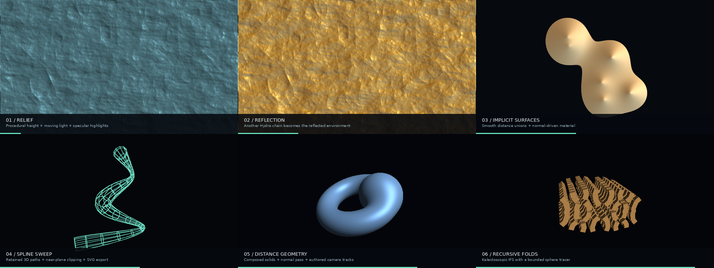

# Demoscene tools

This first implementation builds on the existing animated fields and curve
adapters. All shader additions have NumPy reference implementations. No extra
runtime dependencies are required.



[18-second rendered preview](demoscene_preview.mp4)

| Component | Python / desktop GL | Standalone HTML | Geometry retained |
|---|---|---|---|
| normalMap, relight, envMap, refractMap | Yes | Yes | Input field remains available |
| sdfMetaballs | Yes | Yes | Signed field, composed with existing SDF ops |
| SDF3 / raymarch | Yes | Yes | SDF3.distance evaluates arbitrary 3D points |
| Recursive SDF3.fold | Yes | Yes | Same field interface |
| catmull_rom / sweep_wire / lathe_wire | NumPy geometry; FrameSource for animation | Bake animation into Bank | 3D paths and projected SVG paths |
| Track / Timeline | Yes | Yes | Named cue data exports to JSON |

These extensions do not add corresponding operators to the upstream Hydra JS
runtime. Use HydraPy's standalone HTML exporter for the shader versions.

## Height fields and materials

```python
from hydrapy import *

height = fbm(4).add(veins(3), .3).bake()
normals = height.normalMap(strength=.035)
light = normals.relight(azimuth=Time() * .3, elevation=.7,
                        ambient=.18, diffuse=.65, specular=.4, shininess=40)
light.color(.4, .65, .7).out(o0)

environment = osc(3, .1, .7).rotate(.7).bake()
environment.envMap(normals).mult(light).out(o1)
grid(12).refractMap(normals, amount=.06).out(o2)
```

`normalMap` uses the **red channel** as height. Use `.g()` or `.a()` first when
the simulation stores the relevant state in another channel. It preserves the
input alpha and uses wrapping texture samples. `strength` measures height in
screen-height units; changing resolution does not change the intended slope.
`radius` is the finite-difference sampling distance in pixels (minimum 0.5).
Increasing it can reduce derivative noise in half-float feedback textures.

Normals are encoded as `RGB = 0.5 + 0.5 * normal`, with +Y up and +Z toward
the viewer. `relight` expects these normals, returns grayscale illumination,
and preserves alpha. Its light angles are radians. Illumination may exceed 1
before display; apply tone/colour operations as desired.

`envMap` samples a chain as a latitude/longitude environment. A view-facing
normal samples UV (0.75, 0.5), and rotation is in turns. Supply silhouette
coverage explicitly with `.alpha(normals.a())` when needed. `refractMap` is a
normal-driven screen-space distortion, without thickness or physical refraction.

Raw signed fields and HDR height values need float intermediate targets.
WebGL's 8-bit fallback cannot preserve those values; map the height into 0..1
before a texture pass when targeting that fallback.

Example: [materials](../patches/demoscene_materials.py).

## Animated implicit shapes

```python
field = sdfMetaballs(count=6, radius=.13, spread=.26,
                    smoothness=.16, speed=.6, seed=2)
field.sdfSubtract(sdfBox(.12, .8)).sdfMask().out(o0)
field.sdfBands(30, .18, Time() * .15).out(o1)
```

This is a polynomial smooth union of moving circles, with negative distance
inside. Count is bounded to 1..16, and motion is evaluated from absolute time.
It composes with the existing 2D SDF operations; `sdfBands` is a raster band
renderer, not an SVG contour tracer.

Example: [metaballs](../patches/demoscene_metaballs.py).

## Splines and wireframes

```python
curve = catmull_rom([[-.5, -.6, 0], [.3, -.2, .4],
                    [-.3, .3, -.3], [.5, .7, 0]], samples=16)
paths3d = sweep_wire(curve, radius=.08, sides=12, twist=1.2, rings=3)
paths2d = project_wire(paths3d, rotY=.5, distance=3, aspect=1)
svg = to_svg(paths2d, size=(2970, 2100), stroke=2)
```

The spline interpolates its controls; `samples` is per segment. The sweep
accepts an open 3D curve, a scalar radius or one radius per vertex, and a total
twist in radians. `rings=3` draws every third cross-section, including the ends;
zero disables cross-sections. `lathe_wire(profile, sides=24)` revolves a
`(radius, y)` profile around Y.

`project_wire` clips segments against the camera near plane and preserves
separate path pieces. Returned coordinates use Y-up normalized image space.
Use `Lines(..., fit=False)` to preserve the camera framing. These are transparent
wireframes: there is no hidden-surface removal. Animation can use FrameSource,
while the original paths remain available for vector/plotter processing.
For screen rendering, set `aspect` to canvas width/height. For `to_svg`, use
`aspect=1`: the SVG exporter fits the geometry uniformly to the page, so square
coordinate units preserve the projected shape.

Export an A4-proportioned study (SVG coordinates, not device motion commands):

```sh
python patches/demoscene_wire.py --svg sweep.svg --time 2
```

[Example SVG at t=2](demoscene_sweep.svg).

## Composable 3D fields

```python
scene = SDF3.torus(.65, .22).rotate(.4, 0, .2).union(
    SDF3.sphere(.42).translate(Lfo(.12, lo=-.5, hi=.5), .15, 0), .22)
scene = scene.subtract(SDF3.box(.13, .9, .13))
raymarch(scene, rotY=Time()*.2, distance=3, mode=0).out(o0)
```

Primitives are spheres, boxes (half-extents), and Y-axis tori. Operations are
translation, XYZ rotation, uniform scale, union with optional smoothing,
intersection, subtraction, and recursive folding. Numeric parameters accept
scalar Signals; arbitrary image fields are not accepted as distance bounds.

`raymarch` returns an ordinary chain. Camera controls are `rotX/Y/Z`, `distance`
and vertical `fov` in degrees. Rotation turns the scene about the origin.
`mode=0` returns lit grayscale, `mode=1` view-space encoded normals, and `mode=2`
ray distance divided by `far`. Misses have zero alpha. Normal output can feed
`relight` or `envMap` for materials. `field.distance(points, ctx)` evaluates
the same signed field for external geometry sampling.

The marcher limits work to 1..256 steps (default 96), stops at `far` (default
10), and uses an absolute hit tolerance `epsilon` (default .001). Very small
details can disappear at coarse tolerances or low step counts. There are no
shadows, reflection bounces, or shared depth testing between separate Hydra
layers; compose intersecting objects within one SDF3 scene.

```python
fractal = SDF3.box(.45, .45, .45).fold(
    iterations=3, scale=2.1, x=.7, y=.6, z=.65,
    angle=Lfo(.06, lo=.05, hi=.32))
raymarch(fractal, steps=160, rotY=Time()*.2).out(o0)
```

`fold` repeatedly applies absolute-value folding, Z rotation, scaling and
translation before evaluating its child shape. It compensates the distance
by the accumulated scale. Iterations are structural (1..10); other parameters
can animate. This first version supplies kaleidoscopic IFS geometry, without
orbit-trap colouring or Mandelbulb/Mandelbox implementations.

Examples: [composed scene](../patches/demoscene_sdf3d.py),
[recursive folds](../patches/demoscene_fractal.py).

## Music-directed parameter tracks

```python
cues = Timeline({
    'camera': Track([(0, 3.8, 'smooth'), (4, 2.9), (12, 4.0)]),
    'mix': Track([(0, 0, 'step'), (16, 1, 'smooth'), (32, .3)],
                 units='beats', bpm=120),
})
raymarch(scene, distance=cues['camera']).out(o0)
cue_json = cues.to_json()
same_cues = Timeline.from_json(cue_json)
```

Tracks hold their endpoint values outside the keyed range. Each key owns the
interpolation to the next key: `step`, `linear`, `smooth` (smoothstep), or `ramp`
(quadratic ease-in). Beat tracks use patch BPM unless they specify their own.
Unlike Seq, Track does not loop. Python, HTML, and generated Python patches
preserve the track and its interpolation.

Timeline JSON is HydraPy's own cue format, not Rocket's binary format or editor
network protocol. Seeking a track reconstructs its value only. Stateful
feedback/NCA/physarum still needs its own reset/replay or checkpoint support.

## Reproduction and provenance

```sh
python docs/demoscene_demo.py --out demo.mp4 --contact demo.png
python -m pytest tests -q
```

The preview probes hardware encoders and falls back to libx264 when none works.
No hardware-specific performance claims are made from the software GL test host.

Algorithm/design references:

- [Fabian Giesen's OpenKTG](https://github.com/farbrausch/fr_public/tree/master/ktg):
  height derivatives, normals, bump lighting, texture operations. The upstream
  reference is public domain. Our material operators use independent floating-point
  implementations and HydraPy's straight-alpha conventions.
- [Mercury hg_sdf](https://mercury.sexy/hg_sdf/): distance bounds, Boolean modeling,
  and the requirement to preserve valid stepping bounds. Available under MIT
  or CC-BY-NC-4.0. This implementation does not bundle the library.
- [Ctrl-Alt-Test's geometry breakdown](https://www.ctrl-alt-test.fr/2023/procedural-3d-mesh-generation-in-a-64kb-intro/):
  spline profiles, surfaces of revolution, curve sweeps, and implicit surfaces.
- [Fragmentarium](https://github.com/Syntopia/Fragmentarium): reference for
  distance-estimated fractal exploration. No example shaders are copied here.
- [Rocket](https://github.com/rocket/rocket): sparse tracks and its four
  interpolation modes. Track implements the interpolation independently.

New code remains under the repository's AGPL-3.0-or-later license.
