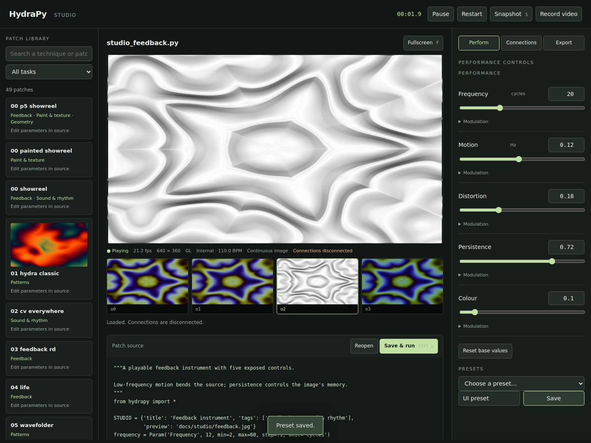

# HydraPy Studio

[Documentation](README.md) · [Project home](../README.md)

For a fullscreen score and separate Program/Auxiliary windows, see the optional
[Gorgon tracker workspace](gorgon-tracker.md) (`hydrapy studio … --tracker`).

```sh
python -m pip install -e ".[gpu,video]"
hydrapy studio patches/studio_feedback.py
```

Studio opens a local browser workspace and renders the patch in Python. It works with
CPU-only operations, Python textures and the GL backend; it does not substitute an HTML
export for the running patch. With no GL context, `--backend auto` selects CPU. Shader
errors remain visible. `--backend cpu` and `--backend gl` select explicitly.

Run from your checkout to browse `patches/`, or use `--root /path/to/project`. The default
preview is 640×360 at a target 30 fps. Use `--size 960x540 --fps 24` to change it.
`--port 0` chooses a free port; `--no-browser` just prints the local URL. Keep the full
URL, including its session fragment. The server binds only to 127.0.0.1.

On Linux with an X display, Studio renders in a hidden window's GL context, so the
Gorgon tracker's Display menu can show Program fullscreen on a monitor straight
from the GPU, paced by its refresh ([fullscreen output](gorgon-tracker.md#control-surface-and-displays)).
`--native-output MONITOR` (a name such as `DP-5`, an index, or `window`) starts with it
showing and renders at that monitor's size unless `--size` is given;
`--no-native-output` renders without a window. `--edit-delay-ms` sets how long the
tracker gathers edits before sending them (120 ms, or 0 while the fullscreen output shows).

The selected preview requests the next available JPEG as soon as the previous image
is decoded and scheduled for display, independently of the 250 ms controls/status
poll. At most one request/decode is in flight. Slow clients receive the latest frame;
they do not accumulate a playback queue. Switching outputs or reloading invalidates
old captures and in-flight browser results. Hidden tabs suspend preview requests.

JPEG encoding runs in a separate worker with one replaceable pending main frame and
up to four pending thumbnails. Only the selected output gets full-size JPEGs.
Thumbnails refresh about twice a second each, staggered across render ticks. With no
viewers, requests stop driving captures and the thumbnail lease expires after two
seconds. Encoding/HTTP failures do not pause synthesis. GPU readback still runs on
the GL thread and can wait for the GPU; this change does not add asynchronous PBOs
to Studio or change render resolution, precision, simulation clocks, feedback, or
live hooks. Recording reads every synthesis frame and snapshots read a fresh lossless
frame, independently of preview delivery.

Open **Preview performance** for delivered frame rate and stage timings. GPU timer
queries are opt-in; leave them off for an ordinary performance. See
[preview measurement and regression checks](#measure-preview-performance) below.



## Work with a patch

- Search examples by technique or task. Discovery reads source metadata without running
  the examples. Previews are cached after you run a patch. The supplied Studio examples
  include preview images and explicit performance controls.
- Edit Python and **Save & run** (Ctrl/Cmd+Enter). External saves are watched too. Reopen
  reads the file again; a version check prevents overwriting a simultaneous external edit.
- **1–4** selects an output. **Space** pauses image updates, **S** saves a PNG, and **F**
  opens the preview fullscreen. Shortcuts do not fire while typing in a field.
- The status strip shows measured synthesis rate, resolution, backend, clock and hardware
  state. All four output thumbnails remain available. **Restart** clears feedback and
  restarts the patch at zero; a successful same-file edit carries feedback history and the
  named control settings over. Feedback carries over when the backend stays the same;
  stateful source internals such as NCA/Physarum restart.
- The browser interface contains the patch image, not an audio monitor. File-based audio
  analysis advances with the preview clock; hear the soundtrack in the exported video or
  through the patch's explicitly enabled audio routes.

Python remains executable code with your local permissions. Studio runs trusted patches;
its local HTTP token is an access boundary, not a Python sandbox. Only files within the
workspace root can be opened/saved through the interface. A user script's independent
file, process or network side effects cannot be undone by reload recovery. Generated
`.hydrapy/` settings, presets, previews and exports obey the same workspace boundary;
symlinks that point outside the workspace are refused. Text saves use exclusive temporary
files in the destination directory and replace the destination only after writing succeeds.

## Declare performance controls

```python
from hydrapy import *

frequency = Param("Frequency", 12, min=2, max=60, step=.1, unit="cycles")
warp = Param("Distortion", .18, min=0, max=.6, step=.005,
             description="How strongly the noise bends the source.")
osc(frequency, .08, .7).modulate(noise(3), warp).out(o0)
```

A `Param` is a signal, with the same arithmetic as `Lfo` and `Audio` signals. Its slider
bounds are suggestions: numeric entry may exceed them. `scale="log"` requires positive
bounds. `group=` groups controls; names must be unique within a patch.

The inspector can add a sine LFO (rate in Hz) or beat envelope (rate in cycles per beat).
Depth uses the parameter's units. For custom modulation, use `warp.bind(signal, depth)`
in Python. Presets retain base values and modulation settings under `.hydrapy/presets/`.
Changing a base value does not stop its modulation. **Reset base values** deliberately
keeps the modulation configuration.

Construction arguments of signals such as `Lfo` are still literal numbers. For a named
frequency control, `(Time() * motion * 6.283185).sin()` is a signal expression; changing
its frequency changes its phase relationship to the clock. Live Param base values are
captured in standalone HTML exports, while their declared modulation continues.

The operator `Input` metadata also accepts `minimum`, `maximum`, `unit` and `scale` for
custom inspector tooling; these are hints and do not clamp operator evaluation.

## Connections and reload

The Connections panel displays managed CV/OSC/MIDI/Link/video resources, channels, signal
routes and errors. List available devices, then set device names and routes in the patch.
**Enable connections** validates and reloads the patch before opening them. **Disconnect**
reloads into preview mode. Pausing the image does not disconnect hardware.

A candidate's device opens are deferred until the patch loads and its renderer compiles.
Syntax, patch-construction and shader errors retain the running patch and its devices.
A failed device activation attempts to reconnect the previous devices and reports any
failure to do so. Successful reloads briefly reopen hardware; they are not gapless audio
switches. Feedback history is copied; arbitrary external state is not.

What you did in the session survives a reload unless the edit changed it. A control keeps its
slider value if its default in the code is unchanged, and keeps its modulation (none/LFO/beat, or
the depth of a declared `bind()`) if its `bind()` is unchanged; add, remove or change either in
the code and the code wins. The output you chose stays on screen unless the edit changed the
patch's `render()`. "Declared in patch" stays in a control's modulation menu, so a declared bind
can be chosen again after switching to an LFO.

Recording via a patch's own `VideoOut` or file-mode `CvOut` follows that object's lifecycle.
A successful reload closes the previous recording and creates the replacement. Use
unique recording destinations to avoid overwriting previous takes. Studio's separate
**Record video** action blocks patch reloads until recording is stopped.

## Record and export

**Record video** captures the running preview at wall-clock speed, repeating held frames
when rendering falls behind. It records video only. Stop to finish and download the MP4.

Each recording also gets a sidecar, `take.timestamps.json` beside `take.mp4`, written when
it stops (the `record` response names it as `timestamps`). For every encoded frame it holds
the `time.monotonic()` the frame was presented (the native output's flip, otherwise its
readback) in `present`, and the time it was rendered for in `rendered`. A repeated frame
repeats its stamps. `origin` is the monotonic time of video time 0: video time `v` is
monotonic time `origin + v`. While Studio's JACK audio runs, `jack` adds the samplerate and,
in `frame_time`, the 32-bit JACK frame time at each present (what `client.frame_time` reads
then), taken from the process callback's last cycle.

To put audio captured elsewhere (Rack's mix, say) under the video exactly, note when the
capture's first sample happened: its JACK frame time (a JACK recorder reads
`client.last_frame_time` in the process callback that writes its first block) or its
`time.monotonic()`. Then:

```sh
python -m hydrapy.recording take.mp4 --audio-start-frame 123456              # print the offset
python -m hydrapy.recording take.mp4 capture.wav take-av.mp4 --audio-start-frame 123456
```

The helper fits a line through the (present, JACK frame time) pairs, reads the JACK frame
time at video time 0 from it, and trims or delays the audio by the difference. The video is
copied unchanged. It also reports `drift_ppm`, how much faster the JACK clock ran than the
monotonic clock. `hydrapy.recording.offset()` returns the same number for your own mux.
For a finished piece with music, use an offline MP4 export and specify an audio file
inside the project, for example `media/track.flac`. The rendered video duration
controls the export: shorter audio is padded with silence and longer audio is cut
at the video end. Original music and local exports are
ignored by Git. A declared `Soundtrack` is used when no external audio file is selected.

Offline exports use the last successfully running source and a snapshot of its current
controls. They run in a separate process, starting at zero with fresh feedback; live
hardware inputs are disconnected. PNG exports evaluate at the current preview time
with fresh feedback; use **Snapshot** for the exact current image. Export jobs expose
progress, the actual selected encoder, errors and a download button. Exports are saved
under `.hydrapy/exports/`; closing Studio terminates unfinished export jobs.

The compatibility check reports CPU-only operators, Python textures that require baking,
live values that become fixed, sampled Python loops, and browser requirements. This checks
the patch structure, not whether a future browser has the required GPU extensions.

```sh
hydrapy check patches/studio_feedback.py --target html
hydrapy check patches/37_beats_and_flow.py --target html --json
hydrapy ops marble
hydrapy ops --kind texture
```

`check` stages managed devices without opening them. Arbitrary patch code still runs.
MP4 encoding tries available hardware before software; `--gpu`/GL rendering and video
encoding are independent choices. The inspector reports the encoder actually used.

## Status and the Program route

`GET /api/status` (with the session token, like the other API calls) says whether a patch
is ready. `state` is `idle` before any load, then `loading` (the patch file runs),
`compiling` (its shaders), `prewarming` (every scene's variant and the score's crossfades),
and `ready` or `error`. `error` holds the failure, `seconds` the load's duration so far,
`compiled_variants` the shader variants compiled, `banks` the patch's Banks, and
`prewarmed_banks` and `bank_frames` how many of them, and of their frames, are already on
the GPU. `ready`, `patch`, `playing`, `recording`, `route_notice` and `audio` (the JACK
panel's state) complete it. `hydrapy studio PATCH` serves the API before it loads the
patch, so a script can poll `/api/status` from launch until `ready`. A startup patch that
fails still stops Studio. A reload that fails leaves the previous patch running, with
`state` `error`.

A patch's `render(oN)` names the output it composites onto. The score's Program route
(`modes.program`) chooses what Program shows. When they disagree, Studio says so. A score
that routes Program to another output (when it is sent, or its route changes) returns a
`notice` with the `tracker_score` response. The notice also shows under **Output routing**
in the tracker and in Studio's notice line. When a different patch loads over such a score,
the patch's output wins, and the `load` response says so. Choosing an output in Studio is
deliberate and clears the notice.

## Example metadata

Patches can declare a literal `STUDIO` dictionary. The browser reads it with `ast.literal_eval`:

```python
STUDIO = {
    "title": "Feedback instrument",
    "description": "A slow feedback field with five performance controls.",
    "tags": ["Feedback", "Sound & rhythm"],
    "preview": "docs/studio/feedback.jpg",
}
```

Without metadata, the browser derives a title, description and task tags from the source.
No node graph or separate project language is required.

For a complete audio-reactive piece with seven scenes and moving crossfades, see
the [Bullfrog demo](bullfrog-demo.md).

## Measure preview performance

For long renders with concurrent audio, see [stress-test diagnostics](studio-diagnostics.md):
`--diagnostics FILE` retains bounded timing summaries, scene markers and upstream
audio counters without changing the audio callback.

The browser retains the latest 300 measurements in `window.hydrapyPreview.samples`.
The authenticated `/api/frame?output=o0&after=SEQUENCE` endpoint waits at most one
second for a newer selected frame, returning a JPEG with `X-Preview-Sequence`,
`X-Preview-Age-Ms`, and `Server-Timing` headers, or an empty 204 response. Status
reports encoder replacements, bounded pending-slot counts, and preview errors.

| Measurement | Scope and limitation |
| --- | --- |
| `render_cpu_ms` | Wall time in `renderer.step()`, including Python, GL submission and live hooks. It is not GPU-only time. |
| `gpu_ms` | Optional GL elapsed-time query around the same step. Read only after the normal readback has completed; unavailable on CPU. Software GL reports software-renderer execution here. |
| `readback_ms` | Wall time for selected-output presentation, framebuffer download and RGB conversion. Includes any remaining GPU wait; overlaps GPU timing, so these fields must not be added as independent stages. Recording shares its existing readback. |
| `encode_wait_ms`, `jpeg_ms` | Captured RGB waiting for the worker, then image/JPEG encoding. Neither runs on the render thread. |
| `wait_ms` | HTTP handler waiting for a newer encoded image. This is normal when the client catches up. |
| `transfer_ms`, `ttfb_ms` | Browser Resource Timing: response start to end, and request start to first byte. TTFB includes the server wait and network time. Null when the browser has no resource entry. |
| `decode_ms`, `display_wait_ms` | Image decoding and waiting for the next animation-frame callback before inserting the decoded image. Browser scheduling can contribute to decode time. |
| `frame_age_estimate_ms` | Server render-start-to-send duration plus browser headers-received-to-display scheduling. Excludes first-byte transit and physical monitor scanout. Clocks are not assumed synchronized. This is an estimate, not a camera-measured end-to-end latency. |

Run the real page in headless Chromium with both a simple oscillator and an expensive
four-output noise/blur/feedback composition:

```sh
python -m pip install -e '.[gpu,test,video]' playwright
python -m playwright install chromium
python docs/studio_preview_benchmark.py --backend gl --size 640x360 --json preview.json
python docs/studio_preview_benchmark.py --backend gl --size 640x360 --profile --json profiled.json
HYDRAPY_BROWSER_TESTS=1 python -m pytest tests/test_studio.py tests/test_studio_preview.py tests/test_studio_preview_browser.py -q
```

`--case single` / `--case multi`, `--fps`, `--seconds`, and `--warmup` control the run.
`--checkout /path/to/base` runs the same browser harness against another checkout,
including the original polling page. Reports identify the actual imported package,
commit, dirty-tree status, Python, browser and GL renderer, and median/p95 stage times.
Do not compare runs while another benchmark or test suite is competing for the same
CPU/GPU. The browser tests are explicit opt-in; missing Playwright/Chromium fails an
opted-in run rather than silently skipping it. GL tests skip if no GL context exists.

Measured on October 24, 2026 with Mesa llvmpipe (LLVM 20.1.2), Python 3.13.16 and
headless Chromium 134.0.6998.35 at 640×360 / 30 fps: two seconds warmup and five seconds
sampling per case. Baseline is `44c88f4`; the same harness drove both pages. GPU
profiling was off for this comparison. These are short software-renderer measurements,
not physical Ubuntu GPU results or guaranteed rates.

| Synthetic patch | Before: browser fps | After: browser fps | Before / after: render fps | After: frame age estimate, median / p95 |
| --- | ---: | ---: | ---: | ---: |
| Single oscillator | 4.0 | 23.2 | 30.0 / 30.0 | 26.4 / 39.7 ms |
| Four outputs, noise/blur/feedback | 4.0 | 18.2 | 28.5 / 30.0 | 46.0 / 60.5 ms |

A separate run with GPU profiling enabled delivered 29.6 / 18.4 browser fps; timing
and scheduling vary between runs. The original page has no per-frame instrumentation,
so no baseline frame-age estimate is claimed. Persistent HTTP initially introduced
about 42 ms of response-body delay in this environment; `TCP_NODELAY` removed that
delay (final median body transfer about 0.7 ms). Optional GPU timings in the four-output
run were 24.0 ms median, with 2.7 ms readback and 0.9 ms JPEG encoding; GPU/readback
timings overlap as described above.

Regression checks cover bounded latest-frame replacement, stalled encoding and clients,
selection/reload invalidation, thumbnail cadence, pause/resume and visibility handling,
HTTP authorization, and exact CPU/GL feedback and audio equivalence at fixed timestamps.
The existing Studio tests also exercise controls, failed edits, staged hardware, and
real offline PNG export. Physical GPU, ADAT/CV, and a concurrent RAVE workload still
need validation on the Ubuntu performance machine.
